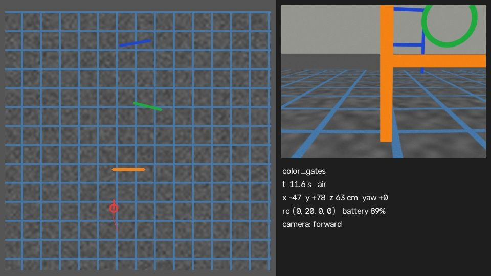

# Tello-Sim-Lab

A **DJI Tello simulator tuned to real flights of the DroneOps lab Tellos**, and the
**controllers that keep a Tello stable**, both extracted from
[DroneOps/AprilTag-Detection](https://github.com/DroneOps/AprilTag-Detection) and generalized
for any Tello project.

- **`tellosim`**: a drop-in replacement for `djitellopy.Tello`. Change one import line and your
  code flies in a 3D simulated world. The camera image, the sensors and the drone's quirks are
  the ones we measured on the lab Tellos.
- **`tellolab`**: altitude hold, heading hold, position hold, visual target centering, safe
  flips, safety watchdogs and a `Pilot` that puts them together. They work the same with the real
  drone and with the simulator.



## Getting started on your computer

Everything below works the same for any Tello project. Your own code does not change.

### 1. Check your Python

```bash
python --version
```

You need **3.10 or newer**. On Windows use `py --version`; on Linux and Mac, `python3 --version`
if `python` is not found.

### 2. Get the simulator

```bash
git clone https://github.com/DroneOps/Tello-Sim-Lab.git
```

- **Without git:** on GitHub, *Code → Download ZIP*, and unzip it.
- **Where:** keep it next to your project, e.g. `Documents/Tello-Sim-Lab` and
  `Documents/My_Project`. The commands below assume that.

### 3. Install it where your project runs

**If your project already has an environment** (a venv or a conda env), install the simulator
into that same one, so your libraries and the simulator live together:
1. Activate it as you always do (`source .venv/bin/activate`, `conda activate my_env`...).
2. Install:
   ```bash
   pip install -e ../Tello-Sim-Lab
   ```
   That is the path to the folder of step 2. `-e` installs it from that folder, so a `git pull`
   there updates it without reinstalling.

**If not,** create one inside `Tello-Sim-Lab`, then install your project's libraries in it too
(e.g. `pip install -r requirements.txt` from your project):

| | Linux / Mac | Windows (PowerShell) |
|---|---|---|
| create | `python3 -m venv .venv` | `py -m venv .venv` |
| activate | `source .venv/bin/activate` | `.venv\Scripts\Activate.ps1` (cmd: `.venv\Scripts\activate.bat`) |
| install | `pip install -e ".[dev,real]"` | `pip install -e ".[dev,real]"` |

`real` adds djitellopy (to fly the real drone), `dev` adds pytest.

Check that it works, with the environment active:

```bash
python -c "import tellosim; print(tellosim.builtin_maps())"
```

It prints the maps (`lab_grid`, `tmr_gates`, `tmr_landing`...).

### 4. Run your program

Go to your project's **root folder**, where its own files and folders are, so it finds them:

```bash
cd ../My_Project
```
```bash
python -m tellosim.run --world tmr_landing --viewer main.py
```

- **`--world`:** the map, e.g. `tmr_gates`, `tmr_landing`, `line_follower`, or your own `.yaml`
  ([docs/maps.md](docs/maps.md)).
- **`--viewer`:** a second window with the map from above.
- **After your program's name:** its own arguments, e.g. `main.py --solo-seguimiento`.
- **Keys:** if your program waits for a key (e.g. `t` to take off), click its window and press
  it, or let the simulator press it: `--keys t@6` presses `t` 6 s after the start.
- **Every option** (`--record`, `--fog`, `--model`, `--seed`...):
  [docs/your-code.md](docs/your-code.md).

### 5. Read the result and clean up

At the end it prints what really happened, which the real drone never tells you:

```text
[tellosim.run] flight time 57 s, battery 84%, crash: none
[tellosim.run] gate gate1: flown through
[tellosim.run] landing pad pad: touched down 64 cm from its center (off it), at 61 s
```

If your program saves its own logs or videos, the ones from this run come from the simulator:
rename or delete them so they do not get mixed with real flights.

### 6. Update

`git pull` in the `Tello-Sim-Lab` folder (with the ZIP: download it again and unzip it over the
old one). Nothing to reinstall.

### Different computers and projects

| Case | What to do |
|---|---|
| **Windows** | If PowerShell refuses to run `Activate.ps1`: `Set-ExecutionPolicy -Scope CurrentUser RemoteSigned` once. Quotes inside a command break easily, so use `--fog 300` or put the options in a file: `--fog fog.json`, `--faults faults.json` |
| **Mac** | The viewer opens its window from a second thread, and OpenCV on a Mac only allows windows on the main thread, so `--viewer` will probably fail. Use `--record run.mp4` and watch the video. Not tested on a Mac yet: if you try it, open an issue with what happened |
| **Linux** | Tested here. On a minimal install OpenCV may ask for `sudo apt install libgl1` |
| **No screen** (a server, WSL without windows) | `--headless --record run.mp4` |
| **Your environment has `opencv-contrib-python`** (or `opencv-python-headless`) | pip would add `opencv-python` too, and two OpenCVs in one environment break `cv2`. Install with `pip install -e ../Tello-Sim-Lab --no-deps`, then `pip install numpy pyyaml` |
| **Python 3.9 or older** | It does not install. Install a newer Python and make a new environment |
| **Your program is in a subfolder** (e.g. `tests/my_test.py`) | Run it from the project's root folder: `python -m tellosim.run --world tmr_landing tests/my_test.py` |
| **Your program reads the keyboard with pygame, `keyboard` or Qt** | `--keys` only works with `cv2.waitKey` / `cv2.pollKey`: someone has to press the keys |
| **Your program uses its own GUI** (PySide, Tkinter...) | Install those libraries in the same environment; the simulator does not replace them |
| **Your mirror flips the image sideways** | `--camera-set mirror_axis=h` ([docs/camera.md](docs/camera.md)) |
| **You calibrated your own Tello's camera** | `--camera my_calibration.json` ([docs/camera.md](docs/camera.md)) |
| **A slow computer** | A frame takes ~17 ms on our laptop (~23 with fog). On a slower one the video comes at fewer frames per second than the real ~30; your program still runs. To run many flights, use simulated time ([docs/extending.md](docs/extending.md)) |
| **`AttributeError` with a Tello method's name** | A djitellopy call the simulator does not have yet: open an issue with its name |

## Your code, in the simulator

```python
# from djitellopy import Tello
from tellosim import Tello

tello = Tello()                 # or Tello(world="line_follower", model="lab_tello7", camera_mode="mirror")
tello.connect()
tello.streamon()
frame_read = tello.get_frame_read()
tello.takeoff()                 # ~5 s like the real one, ends at 65–74 cm
tello.send_rc_control(0, 20, 0, 0)
frame = frame_read.frame        # RGB 960x720, ~170 ms late, like the real stream
tello.land()
tello.end()
```

Everything else (your threads, `time.sleep`, OpenCV processing) stays the same.

**Or don't change anything:** run your program as it is, and `import djitellopy` gets the
simulator.

```bash
python -m tellosim.run --world tmr_gates --record run.mp4 my_program.py
python -m tellosim.run --world tmr_landing --keys t@4,l@60 tests/test_tracking.py   # presses t, then l
python -m tellosim.run --world tmr_gates --fog '{"visibility_cm": 600, "patches": 0.5}' my_program.py   # with smoke
```

At the end it prints what really happened: crashes, where it ended, gates flown through. How, and
what we saw with the group's projects: [docs/your-code.md](docs/your-code.md).

To see what is going on from above:

```python
viewer = tello.sim.viewer(record="run.mp4")   # map from above + camera, live and recorded
print(tello.sim.pose())                        # the TRUE position, which the real drone never gives you
```

### What it reproduces (measured on the lab Tellos)

| Behavior | Real lab Tello | Where it is |
|---|---|---|
| rc deadband and lag | below rc ~10 it barely moves; ~0.75 s to reach speed | `models/*.json` |
| sinks when flying forward + sideways | ~8 cm/s | `combo_sink_cm_s` |
| drifts by itself | random ~5 cm/s; Tello #7 always ~12 cm/s to its right | `random_drift_cm_s`, `drift_right_cm_s` |
| slides when turning, keeps turning after stopping | 26–42 cm in a 90° turn; 88° → 101° | `turn_drift_cm_s`, `yaw_carry` |
| takeoff | 65–74 cm, ok after 4.5–7.8 s, rc ignored until then | `takeoff_*` |
| falls after a flip | ~50 cm/s for 1–3 s | `flip_fall_*` |
| ToF reads height + 10 cm, garbage mid-flip; `h` unreliable | yes | sensors in `drone.py` |
| video delay | ~170 ms | `video_delay_s` |
| standard Tello answers `unknown command` to `sdk?` and `sn?` | yes | `tello.py` |

And what it does **not** reproduce: motion blur, reflections, a dirty mirror, WiFi drops (unless
you turn on `video_dropouts`), and the forward speed with a mirror (the model is ~1.6x faster
than what we measured with the mirror clip). See [docs/how-it-works.md](docs/how-it-works.md).

## Stable flight on the real drone too

```python
from tellolab import Pilot

pilot = Pilot(tello, frame_read=tello.get_frame_read())
pilot.takeoff(altitude_cm=100)     # preflight checks, takeoff, climb to 100 cm
pilot.set_rc(0, 20, 0, 0)          # your commands; 0 on an axis = hold it (altitude, heading)
pilot.flip("b")                    # climbs to 130 cm, flips, brakes the post-flip fall
pilot.land()
print(pilot.reason)                # why the safety monitor landed it, if it did
```

See [docs/controllers.md](docs/controllers.md) for each controller and how to tune it.

## Examples

Each one flies in the simulator, and on the real Tello with `--real`:

```bash
python examples/hover_hold.py              # Tello #7 drifting, held in place with the floor seen by a mirror
python examples/line_follower.py           # follow a black line with a downward mirror
python examples/color_gate.py              # fly through orange, green and blue gates
python examples/landing_pad.py             # find a pad and land on it
python examples/aruco_follow.py            # stay 1.2 m in front of an ArUco marker
python examples/apriltag_mission.py        # tags on the floor: turn, flip, land...
```

Add `--no-window` to run without the video window, `--model lab_tello7` for a drifting drone.
Results in the simulator and how to move them to the real drone:
[docs/examples.md](docs/examples.md).

## Make it yours

| I want to... | Read |
|---|---|
| run my existing djitellopy program, without changing it | [docs/your-code.md](docs/your-code.md) |
| build my own track (lines, markers, gates, boxes, walls, my floor) | [docs/maps.md](docs/maps.md) |
| a platform that moves, fog or smoke | [docs/maps.md](docs/maps.md#moving-objects), [fog](docs/maps.md#fog-and-smoke) |
| check that my map is right (textures, collisions, sizes) | `python tools/check_maps.py my_track.yaml` ([docs/maps.md](docs/maps.md#check-your-map)) |
| use another Tello's calibration, the forward camera or a mirror | [docs/camera.md](docs/camera.md) |
| make the simulated drone behave like MY drone | [docs/drone-model.md](docs/drone-model.md) |
| test what happens when things go wrong | [docs/faults.md](docs/faults.md) |
| add new object types, sensors, physics; run faster than real time | [docs/extending.md](docs/extending.md) |

## Tests

```bash
pytest -q
```

They run in simulated time (seconds), also on every push (GitHub Actions).

## Where this comes from

Built by the DroneOps drone team (Tec de Monterrey) for the Autonomous Mechatronics Grand Prix
2026 AprilTag challenge. The numbers come from lab sessions in Oct–Nov 2026: the flight logs and
notes are in AprilTag-Detection (`sesiones/`, `docs/tello.md`). MIT license.
